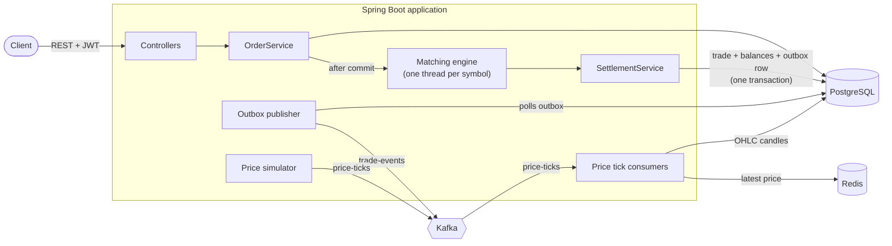

# Crypto Trading Simulator

[](https://github.com/meliskara-dev/Crypto-Trading-Simulator/actions/workflows/ci.yml)

A small virtual crypto exchange built with Spring Boot. Users register, receive a demo balance, place limit orders on BTC, ETH and SOL, and an in-memory matching engine fills them against each other. Prices come from a random-walk simulator and are streamed through Kafka.

No real money, no real exchange connection. The point of the project is what happens beyond CRUD:

- **Concurrency**: orders arriving at the same time are matched in a strict order without races.
- **Consistency**: a balance can never go negative, and the same order is never processed twice.
- **Asynchronous architecture**: prices and trade events flow through Kafka, with retries, a dead-letter topic and a transactional outbox.
- **Quality**: unit, integration and concurrency tests, CI on every push, one command to run everything.

## Contents

- [Tech stack](#tech-stack)
- [Architecture](#architecture)
- [Quick start](#quick-start)
- [Try it with curl](#try-it-with-curl)
- [API overview](#api-overview)
- [Design decisions](#design-decisions)
- [Known limitations](#known-limitations)
- [Tests](#tests)
- [Local development](#local-development)

## Tech stack

| Area | Choice |
|---|---|
| Language / framework | Java 21, Spring Boot 4.1, Maven |
| Database | PostgreSQL 16, schema managed by Flyway (`ddl-auto: validate`) |
| Cache | Redis 7 (latest price per symbol) |
| Messaging | Apache Kafka 4.1 in KRaft mode (no ZooKeeper) |
| Security | Spring Security, OAuth2 Resource Server, HMAC-signed JWT access tokens + opaque refresh tokens |
| API docs | springdoc-openapi (Swagger UI) |
| Observability | Spring Boot Actuator, Micrometer Tracing (trace ids in logs) |
| Testing | JUnit 5, Mockito, AssertJ, Testcontainers, Awaitility, JaCoCo |
| Delivery | Docker Compose, GitHub Actions |

## Architecture

The application is a **modular monolith**: one deployable, split into modules by business area rather than by technical layer. A module never touches another module's repository; it calls the other module's public service instead.

```
auth/     registration, login, JWT and refresh tokens
wallet/   balances (available / locked)
market/   price simulator, latest price, OHLC candles, 24h stats
order/    orders, order book, matching engine, settlement, trades
common/   error handling, configuration, transactional outbox
```



### Life of an order

1. `POST /api/orders` validates the request and checks the `Idempotency-Key`. If the key was already used, the existing order is returned.
2. In one database transaction the funds are moved from `available` to `locked` (quote currency for a buy, base asset for a sell) and the order is saved as `NEW`.
3. **After the transaction commits**, the order is handed to the matching engine thread for its symbol.
4. The engine matches it against the in-memory order book using price-time priority. Trades execute at the resting (maker) order's price.
5. For each batch of matches, `SettlementService` updates both orders, moves locked funds between buyer and seller, refunds a buyer's price improvement, inserts `trades` rows and writes a `TradeEvent` to the outbox, all in one transaction.
6. The outbox publisher sends unpublished events to the `trade-events` topic and marks them as published.

## Quick start

Requirements: Docker with Docker Compose.

```bash
git clone https://github.com/meliskara-dev/Crypto-Trading-Simulator.git
cd Crypto-Trading-Simulator
docker compose up -d --build
```

The first build downloads Maven dependencies and takes a few minutes. When the app is up:

| What | URL |
|---|---|
| Swagger UI | http://localhost:8080/swagger-ui.html |
| Health | http://localhost:8080/actuator/health |
| API base | http://localhost:8080/api |

Stop everything with `docker compose down`. Add `-v` to also delete the database volume.

Every new user starts with a demo balance of **10,000 USDT, 1 BTC, 10 ETH and 100 SOL**, so two freshly registered users can trade with each other right away.

## Try it with curl

The commands below use bash and [`jq`](https://jqlang.org/) to pick values out of JSON responses (on Windows: Git Bash, plus `winget install jqlang.jq`). Run them on a fresh database; idempotency keys are fixed strings so a re-run returns the existing orders. The same flow can be clicked through in Swagger UI: log in, press **Authorize**, paste the access token.

**1. Register two users and log in**

```bash
BASE=http://localhost:8080/api

for user in alice bob; do
  curl -s -X POST $BASE/auth/register \
    -H 'Content-Type: application/json' \
    -d "{\"email\":\"$user@example.com\",\"password\":\"password123\"}"
  echo
done

ALICE=$(curl -s -X POST $BASE/auth/login -H 'Content-Type: application/json' \
  -d '{"email":"alice@example.com","password":"password123"}' | jq -r .accessToken)
BOB=$(curl -s -X POST $BASE/auth/login -H 'Content-Type: application/json' \
  -d '{"email":"bob@example.com","password":"password123"}' | jq -r .accessToken)
```

**2. Check the market and a balance**

```bash
curl -s $BASE/market/BTCUSDT/price | jq
curl -s -H "Authorization: Bearer $ALICE" $BASE/wallet/balances | jq
```

**3. Alice sells 0.1 BTC at 60,000. Bob buys 0.1 BTC at up to 61,000.**

```bash
SELL_ID=$(curl -s -X POST $BASE/orders \
  -H "Authorization: Bearer $ALICE" \
  -H "Idempotency-Key: alice-sell-1" \
  -H 'Content-Type: application/json' \
  -d '{"symbol":"BTCUSDT","side":"SELL","type":"LIMIT","price":60000,"quantity":0.1}' | jq -r .id)

BUY_ID=$(curl -s -X POST $BASE/orders \
  -H "Authorization: Bearer $BOB" \
  -H "Idempotency-Key: bob-buy-1" \
  -H 'Content-Type: application/json' \
  -d '{"symbol":"BTCUSDT","side":"BUY","type":"LIMIT","price":61000,"quantity":0.1}' | jq -r .id)
```

**4. See the result**

```bash
curl -s -H "Authorization: Bearer $BOB" $BASE/orders/$BUY_ID | jq '{status, filledQuantity}'
curl -s -H "Authorization: Bearer $BOB" $BASE/wallet/balances | jq
curl -s -H "Authorization: Bearer $ALICE" $BASE/wallet/balances | jq
```

Both orders are `FILLED`. The trade executes at Alice's price (60,000) because her order was resting in the book first, so Bob pays 6,000 USDT, not 6,100. The extra 100 USDT he had locked is released back to him:

| | USDT | BTC |
|---|---|---|
| Alice | 16,000 | 0.9 |
| Bob | 4,000 | 1.1 |

**5. Idempotency: send the same request twice**

```bash
for i in 1 2; do
  curl -s -X POST $BASE/orders \
    -H "Authorization: Bearer $BOB" -H "Idempotency-Key: bob-retry-1" \
    -H 'Content-Type: application/json' \
    -d '{"symbol":"BTCUSDT","side":"BUY","type":"LIMIT","price":1000,"quantity":0.1}' | jq -r .id
done
```

Both calls print the same order id, and only 100 USDT is locked.

**6. Cancel it and get the funds back**

```bash
ORDER_ID=$(curl -s -H "Authorization: Bearer $BOB" "$BASE/orders?limit=1" | jq -r '.[0].id')
curl -s -X DELETE -H "Authorization: Bearer $BOB" $BASE/orders/$ORDER_ID | jq '{status}'
```

## API overview

| Method | Path | Auth | Description |
|---|---|---|---|
| POST | `/api/auth/register` | – | Create a user and the demo balance |
| POST | `/api/auth/login` | – | Returns an access token (15 min) and a refresh token (7 days) |
| POST | `/api/auth/refresh` | – | Exchanges a refresh token for a new pair; the old one is revoked |
| GET | `/api/wallet/balances` | JWT | Available and locked amount per asset |
| POST | `/api/orders` | JWT | Place a limit order, requires an `Idempotency-Key` header |
| GET | `/api/orders?limit=50` | JWT | Your orders, newest first |
| GET | `/api/orders/{id}` | JWT | One of your orders |
| DELETE | `/api/orders/{id}` | JWT | Cancel an open order and release its remaining funds |
| GET | `/api/market/{symbol}/price` | – | Latest price from Redis |
| GET | `/api/market/{symbol}/candles?timeframe=1m&limit=100` | – | OHLC candles (`1m`, `5m`, `1h`) |
| GET | `/api/market/{symbol}/stats` | – | 24h open, high, low, last and change % |

Symbols: `BTCUSDT`, `ETHUSDT`, `SOLUSDT`.

Errors use [RFC 9457](https://www.rfc-editor.org/rfc/rfc9457) `application/problem+json`. Validation errors include an `errors` object keyed by field name:

```json
{
  "status": 400,
  "title": "Validation failed",
  "detail": "One or more fields are invalid",
  "instance": "/api/orders",
  "errors": { "price": "must be greater than 0" }
}
```

| Status | When |
|---|---|
| 400 | Invalid input, unknown symbol or timeframe, missing `Idempotency-Key` |
| 401 | Missing, invalid or expired token; wrong credentials (same message for unknown email and wrong password) |
| 404 | Order not found, including other users' orders |
| 409 | Email already registered, order not cancellable, concurrent update |
| 422 | Insufficient balance |
| 503 | No price yet for the symbol |

## Design decisions

### 1. One thread per symbol for matching (single writer)

Each symbol has its own order book and its own single-threaded executor. Every add, match and cancel for `BTCUSDT` runs on the `matching-BTCUSDT` thread, one after another.

**Why:** an order book is a shared, constantly changing structure. Protecting it with locks is easy to get wrong and slows down every operation. With a single writer there is nothing to lock: the order of operations is simply the order of the queue, and the book classes stay plain, non-thread-safe Java. Different symbols are independent, so they still run in parallel. This is the same idea used by real matching engines (and by Kafka's one-consumer-per-partition model).

### 2. The order book lives in memory; the database is the source of truth

The book is a pair of `TreeMap`s (bids sorted high to low, asks low to high), each price level a FIFO queue, which gives price-time priority. It is never persisted.

**Why:** matching needs fast access to the best price; a `TreeMap` gives that in O(log n) without a database round trip. Everything that matters (orders, fills, balances, trades) is committed to PostgreSQL, so the book can always be rebuilt: on startup, open orders are replayed in `created_at` order. If settlement fails, the affected symbol's book is rebuilt from the database so memory and database cannot drift apart.

### 3. Hand orders to the engine only after commit

The order service publishes an application event that is handled with `@TransactionalEventListener(phase = AFTER_COMMIT)`.

**Why:** if the engine received the order before the transaction committed, a rollback (for example, insufficient balance) would leave a ghost order in the book, and the engine thread might not even see the row yet under `READ COMMITTED`. Waiting for the commit means the engine only ever sees orders that really exist.

### 4. Locked balances, optimistic locking and database constraints

Each balance has `available` and `locked` columns. Placing an order moves funds from `available` to `locked`; a trade moves locked funds to the counterparty; cancelling moves them back. Balance rows carry a `@Version` column, and the table has `CHECK (available >= 0)` and `CHECK (locked >= 0)`.

**Why:** locking funds at order time means an order can always be settled. You can't promise the same 100 USDT to two orders. Optimistic locking turns a lost update between two concurrent requests into a clean 409 instead of silently overwriting a balance. The `CHECK` constraint is the last line of defence: even a bug in Java can't store a negative balance. A concurrency test fires 100 parallel orders at one account and verifies that `available + locked` is still exactly 10,000.

### 5. Idempotency keys backed by a unique constraint

`POST /api/orders` requires an `Idempotency-Key` header. The key is stored on the order with `UNIQUE (user_id, idempotency_key)`. A repeated key returns the original order.

**Why:** clients retry when a response is lost (timeouts, flaky mobile networks). Without a key, a retry would create a second order and lock funds twice. Checking for an existing key in Java alone isn't enough, because two simultaneous requests can both see "no order yet". The unique constraint guarantees only one insert wins, and the loser re-reads and returns the winner's order. A test sends the same key 10 times in parallel and checks that exactly one order exists.

### 6. Transactional outbox for trade events

Settlement doesn't send to Kafka directly. It inserts a row into `outbox_events` in the same transaction as the trade. A scheduled publisher sends unpublished rows in order and marks them as published.

**Why:** a database commit and a Kafka send can't be made atomic. Sending inside the transaction risks publishing a trade that is then rolled back; sending after commit risks losing the event if the app crashes in between. With an outbox the event is saved exactly when the trade is, and delivery becomes at-least-once. Each event carries the `tradeId`, so consumers can ignore duplicates.

### 7. Kafka keys, retries and a dead-letter topic

Price ticks are keyed by symbol, so all ticks for one symbol land on the same partition and are consumed in order. Two independent consumer groups read the same topic: one keeps the latest price in Redis, the other builds OHLC candles. Failed records are retried twice with a 1 second back-off and then sent to `<topic>.DLT`. Records that can't even be deserialized go straight to the DLT.

**Why:** ordering only matters per symbol, and partitioning by key gives exactly that while still allowing parallelism. Separate groups keep the cache and the candle builder decoupled; either can be slow or down without affecting the other. The DLT stops one poison message from blocking a partition forever, while keeping it for inspection.

### 8. Money is `NUMERIC(38,18)` and `BigDecimal`, and travels as a string

Amounts are never `double`. In the API they are JSON strings such as `"0.1"`.

**Why:** binary floating point can't represent `0.1` exactly, and rounding errors in a ledger add up. On the client side, JavaScript parses JSON numbers as doubles, so even a correct server value could be corrupted. Strings preserve the exact value. Trailing zeros from the database scale are stripped before output.

### 9. Short-lived JWTs, opaque single-use refresh tokens

Access tokens are HMAC-signed JWTs that live 15 minutes and are validated without a database lookup. Refresh tokens are random 32-byte values; only their SHA-256 hash is stored. Each refresh revokes the old token and issues a new one, and the lookup uses `SELECT ... FOR UPDATE` so two parallel refreshes with the same token can't both succeed.

**Why:** stateless access tokens keep every request cheap, but they can't be revoked, so they must expire quickly. Refresh tokens are revocable because they live in the database. Hashing them means a database leak doesn't hand out working tokens, and SHA-256 (rather than BCrypt) is enough because the tokens are already high-entropy and must be looked up by value.

## Known limitations

These are deliberate simplifications for a portfolio-sized project:

- **Only limit orders.** Market orders are modelled in the schema but rejected by the API.
- **Self-trading is allowed.** A user's buy can match their own sell.
- **Single application instance.** The matching engine and the outbox publisher assume one instance. Scaling out would need symbol ownership per instance and `SELECT ... FOR UPDATE SKIP LOCKED` in the outbox publisher.
- **Same idempotency key, different body** returns the original order instead of a 422.
- **Prices restart from fixed values** when the app restarts, so candles show a jump.
- **Trace ids are not propagated to the matching threads**, so engine logs have an empty trace id.
- **No roles.** All authenticated users have the same rights; `/actuator/metrics` needs a token but not an admin role.
- **No `WWW-Authenticate` header** on 401 responses, because they are rendered as problem details by a custom entry point.
- **No volume on Kafka** in Docker Compose. Topics are recreated on startup; trade events published before a restart are lost from Kafka (they remain in `outbox_events` and `trades`).

## Tests

```bash
./mvnw verify
```

Docker must be running: integration tests start PostgreSQL, Redis and Kafka with Testcontainers. `verify` also enforces at least **70% line coverage on service classes** with JaCoCo; the report is written to `target/site/jacoco/index.html`.

| Kind | Examples |
|---|---|
| Unit (plain JUnit) | Order book price and time priority, partial fills, cancel; balance lock/unlock invariants; amount formatting |
| Unit (Mockito) | Order placement locks the right asset and amount; settlement moves funds and refunds price improvement |
| Integration (MockMvc + Testcontainers) | Registration and demo balance, refresh token reuse, market endpoints, a full trade and cancel flow, other users' orders return 404 |
| Concurrency | 100 parallel orders never make a balance negative; 10 parallel requests with one idempotency key create one order |

GitHub Actions runs `./mvnw -B verify` on every push and on pull requests to `main`.

## Local development

Run only the infrastructure in Docker and start the app from your IDE or Maven:

```bash
docker compose up -d postgres redis kafka
./mvnw spring-boot:run
```

Kafka listens on `localhost:9092` for the host and on `kafka:29092` inside the Compose network.

Configuration is read from environment variables, with defaults for local development:

| Variable | Default |
|---|---|
| `DB_URL` | `jdbc:postgresql://localhost:5432/crypto_sim` |
| `DB_USERNAME` / `DB_PASSWORD` | `crypto` / `crypto` |
| `KAFKA_BOOTSTRAP_SERVERS` | `localhost:9092` |
| `REDIS_HOST` / `REDIS_PORT` | `localhost` / `6379` |
| `JWT_SECRET` | a development-only value; set your own (at least 32 bytes) for anything else |
